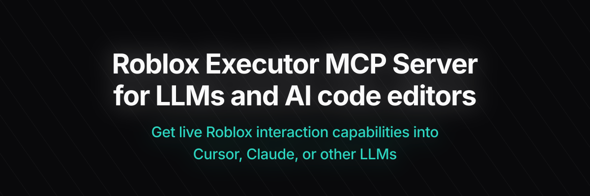

<p align="center">
  
</p>

# Roblox Executor MCP Server

An advanced Model Context Protocol (MCP) server that allows AI agents to interact with running Roblox game clients. This server enables code execution, script decompilation, instance hierarchy querying, remote event spying and firing, and real-time log streaming.

---

## 🚀 Key Features

* **Code Execution** — Run Luau code on the client dynamically, with optional return value yielding.
* **Script Inspection** — Decompile scripts, search across sources, and perform semantic searches.
* **Instance Search & Manipulation** — Use CSS-like selectors, traverse the instance hierarchy tree, and query dynamic properties/attributes.
* **Remote Spy & Fire** — Intercept, log, block, ignore, and fire `RemoteEvents` / `RemoteFunctions` (backed by [Cobalt](https://github.com/notpoiu/cobalt)).
* **Real-Time Log Streaming** — Capture client console outputs dynamically via WebSockets and view them live.
* **GUI Interaction** — Automate input by clicking buttons and typing text into UI elements.
* **OS Integrations** — Retrieve list of Roblox processes and capture client window screenshots (Windows only).
* **Multi-Client Routing** — Coordinate between multiple running clients with automatic Primary/Secondary promotion and relaying.
* **Local Script Hub** — Save, load, and execute pre-configured Luau scripts.

---

## 🖥️ Local Web Dashboard

The Roblox Executor MCP includes a rich, responsive local web dashboard hosted at:
```text
http://localhost:16384/
```

Use the dashboard to monitor connected clients, debug executables, and inspect games:
1. **Console Tab** *(New)*: A real-time stream of the Roblox client console logs (`LogService.MessageOut`), color-coded by log levels: **Info (White)**, **Warning (Yellow)**, and **Error (Red)**.
2. **Executor Tab** *(New)*: A developer-focused suite to write Luau code directly, toggle **"Get Return Value"** to yield and print results, and instantly execute scripts saved in the `user-scripts/` hub.
3. **Tools Tab**: A control center to run all registered MCP tools manually and review inputs/outputs.
4. **Scripts Tab**: Explore local and decompiled scripts, search sources, index game hierarchies, and set up semantic vector search.

---

## 🛠️ Complete Tool Catalog

The server registers a comprehensive list of tools for connected AI agents:

### 1. Client Management
* `list-clients` — Lists all currently connected Roblox game clients.
* `set-active-client` — Selects the active target client for subsequent tool operations.

### 2. Execution Tools
* `execute` — Executes raw Luau code on the active Roblox client.
* `execute-file` — Executes a Luau file from the server's local path.
* `teleport-player` *(New)* — Relocates the player to specific coordinates, offsets, or target players.
* `set-player-property` *(New)* — Modifies character stats (e.g., WalkSpeed, JumpPower, HipHeight, Gravity) or toggles Noclip.

### 3. Inspection & Search Tools
* `get-script-content` — Retrieves the source/decompiled code of a specific script.
* `get-data-by-code` — Queries client metadata using a Luau lookup script.
* `get-console-output` — Returns the history of client console prints and warnings.
* `search-instances` — Finds instances using selectors or names.
* `get-descendants-tree` — Dumps the child hierarchy tree of a specific instance.
* `script-grep` — Performs text searches across all loaded script sources.
* `semantic-search-scripts` — Performs vector-based search on script contents (requires Ollama setup).
* `get-game-info` — Queries game details (e.g., PlaceId, JobId, Player count).
* `get-executor-environment` *(New)* — Returns a checklist of custom APIs supported by the connected Roblox executor (e.g., `getgc`, `hookfunction`).
* `get-instance-properties` *(New)* — Probes attributes, CollectionService tags, and properties of an instance dynamically.

### 4. Remote Spy & Network Tools
* `ensure-remote-spy` — Starts the Cobalt-backed remote spy pipeline.
* `get-remote-spy-logs` — Retreives captured remote calls.
* `clear-remote-spy-logs` — Clears captured logs.
* `block-remote` — Blocks a specific RemoteEvent or RemoteFunction.
* `ignore-remote` — Filters a remote out of the active log stream.
* `fire-remote` *(New)* — Fires a RemoteEvent or invokes a RemoteFunction. Supports dynamically evaluated arguments starting with `loadstring:`.

### 5. GUI & OS Tools
* `click-button` — Fires clicks on specific GUI buttons on the screen.
* `type-text-box` — Focuses and sends text inputs to game TextBoxes.
* `list-roblox-windows` — Lists active Roblox OS window handles.
* `screenshot-window` — Caps and saves screenshots of the game client (Windows only).

---

## 📋 Prerequisites

* **Node.js** ≥ 18
* **Bun** ≥ 1.3 (used for the interactive OpenTUI harness installer)
* **Roblox Executor** — Any executor supporting `loadstring`, `request`, and (preferably) `WebSocket`.

---

## ⚡ Quick Start

### 1. Clone the Repository
```bash
git clone https://github.com/notpoiu/roblox-executor-mcp.git
cd roblox-executor-mcp
```

### 2. Run the Harness Installer
The installer handles server building, configuration generation for your AI client of choice, and prints your loader script:
```bash
npm run install:harnesses
```

> [!TIP]
> If your terminal has issues rendering the interactive OpenTUI picker, run it in plain-text prompt mode:
> ```bash
> npm run install:harnesses -- --plain
> ```

To automatically place the Roblox loader into the `autoexec` folder of a detected executor (e.g. MacSploit, or supported Windows executors), run:
```bash
npm run getscript -- --autoexec
```

### 3. Connect from Roblox
Paste this script into your executor or place it in your `autoexec` folder:
```lua
local bridgeUrl = getgenv().BridgeURL or "localhost:16384"
loadstring(game:HttpGet("http://" .. bridgeUrl .. "/script.luau"))()
```

#### Optional Environment Configuration
Configure these globals *before* running the loader script to customize behavior:
```lua
getgenv().BridgeURL = "10.0.0.4:16384"                  -- Default: localhost:16384
getgenv().DisableWebSocket = true                        -- Forces HTTP fallback polling
getgenv().DisableInitialScriptDecompMapping = true       -- Skips initial project script indexing
```

---

## ⚙️ Client Configuration & Manual Setup

If you prefer to configure your AI interface manually, refer to the guides below:

| Client | Configuration Guide |
|---|---|
| **Cursor** | [Setup Guide](docs/setup-cursor.md) |
| **Claude Desktop** | [Setup Guide](docs/setup-claude-desktop.md) |
| **Claude Code** | [Setup Guide](docs/setup-claude-code.md) |
| **Codex CLI** | [Setup Guide](docs/setup-codex.md) |
| **Windsurf** | [Setup Guide](docs/setup-windsurf.md) |
| **Antigravity** | [Setup Guide](docs/setup-antigravity.md) |

---

## 🛠️ Developer Commands

Maintain, run, or update the server using these project scripts:

* **Build the project** (compiles TypeScript and copies assets to `dist/`):
  ```bash
  npm run build
  ```
* **Start the server**:
  ```bash
  npm run start
  ```
* **Update existing install** (pulls updates, stops running processes, and rebuilds):
  ```bash
  npm run update
  ```

---

## 🔒 Security & Safe Operation

> [!CAUTION]
> **This server allows arbitrary local code execution.** Only connect trusted AI clients. Port `16384` does not enforce authentication—**never expose this port to the public internet**. For cross-machine or LAN setups, secure connections with a local VPN or an SSH tunnel.

---

## 📄 License

This project is licensed under the [MIT License](LICENSE).
