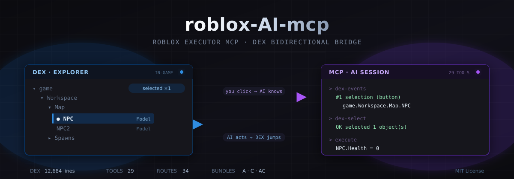
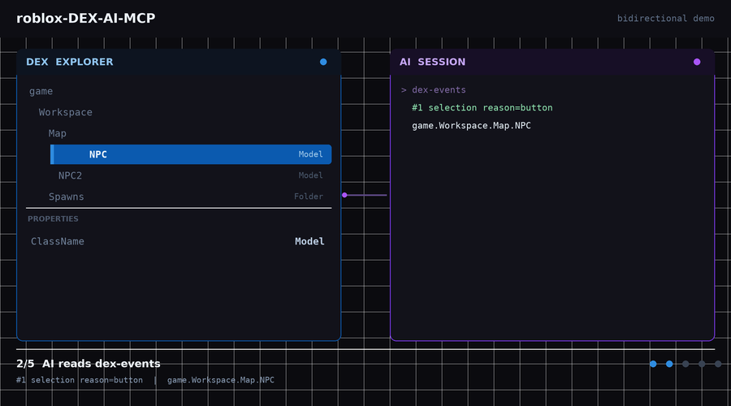

<p align="center">
  
</p>

<h1 align="center">roblox-DEX-AI-MCP</h1>

<p align="center">
  <strong>以 DEX 为中心的双向 AI 桥接</strong><br/>
  <sub>让 AI 知道你在 DEX 里点了什么 · 也让 AI 能在 DEX 里替你点</sub>
</p>

<p align="center">
  <a href="LICENSE"></a>
  <a href="https://nodejs.org"></a>
  
  
  
</p>

<p align="center">
  <a href="README.md">English</a> · <strong>中文</strong>
</p>

---

> ### 🤖 本项目全部由 AI 完成
>
> **从第一行代码到这份 README，全部由 `deepseek-v4.1-flash` 编写。**
>
> 包括：DEX 三套桥接方案、服务端 4 条新路由、3 个 MCP 工具、
> 三份完整版 dex.lua、双语文档、banner 与演示图。
>
> 人类只做了两件事：提出需求、提供 GitHub token。
>
> 详见 [AI 完成度说明](#ai-完成度说明)。

---

## 目录

- [为什么以 DEX 为中心](#为什么以-dex-为中心)
- [快速开始](#快速开始)
- [GitHub Codespaces](#github-codespaces)
- [DEX 集成（主体）](#dex-集成主体)
- [双向工作流](#双向工作流)
- [MCP 工具](#mcp-工具)
- [HTTP 路由](#http-路由)
- [项目结构](#项目结构)
- [AI 完成度说明](#ai-完成度说明)
- [验证记录](#验证记录)
- [已知限制](#已知限制)
- [安全](#安全)

---

## 为什么以 DEX 为中心

大多数 Roblox MCP 项目是这样工作的：**AI 直接操作游戏**。
AI 需要知道「那个红色的东西」到底是什么，只能靠猜路径、试错。

这个项目反过来：**让 DEX 成为 AI 的眼睛和手**。

| 传统 MCP | 本项目（DEX-first） |
|---|---|
| AI 盲猜对象路径 | 你在 DEX 里点，AI 精确知道 `game.Workspace.Map.NPC` |
| AI 改属性后你看不到 | AI 操作后你的 DEX 界面**同步跳转并高亮** |
| 调试全靠猜 | 可视化浏览 + AI 批量操作 |
| AI 和调试器割裂 | 两者是同一条通道的两端 |

DEX 本身已经是个成熟调试器（**12,684 行**，作者 Moon，未混淆）。
我们**不重写它**，只给它接上双向通道。

---

## 快速开始

### 1. 直接用完整版 DEX（零配置）⭐

```lua
-- 在 Roblox 执行器里
loadstring(game:HttpGet("https://raw.githubusercontent.com/986mn/roblox-DEX-AI-MCP/main/dex/builds/dex_AC.lua"))()
```

右下角出现【→ MCP】按钮就成功了。

### 2. 构建服务端（可选，需要 AI 自动收到选中时才用）

```bash
git clone https://github.com/986mn/roblox-DEX-AI-MCP.git
cd roblox-DEX-AI-MCP
npm install --ignore-scripts --no-package-lock
npm run build
node dist/index.js < /dev/zero
```

> `--ignore-scripts` 不能省（`prepare` 钩子会连带触发 build）。
> `< /dev/zero` 不能省（MCP 走 stdio，stdin 一关就退出）。

启动成功：

```
MCP Server started and connected via stdio.
[Router] Loaded 34 HTTP route(s), 1 WS route(s) + WS fallback.
[Primary] MCP Bridge listening on port 16384 (WebSocket + HTTP)
```

### 3. 让 DEX 连上服务端

在**加载 DEX 之前**设置：

```lua
getgenv().BridgeURL = "localhost:16384"                     -- 本机
-- getgenv().BridgeURL = "192.168.1.100:16384"             -- 局域网
-- getgenv().BridgeURL = "https://xxx-16384.app.github.dev" -- Codespaces

loadstring(game:HttpGet("https://raw.githubusercontent.com/986mn/roblox-DEX-AI-MCP/main/dex/builds/dex_AC.lua"))()
```

### 4. 配置 AI 客户端

**一条命令搞定：**

```bash
npm run install:mcp
```

它会自动检测你装了哪些客户端（Claude Desktop、Cursor、Windsurf、Antigravity、
Claude Code、Codex CLI、VS Code），列出编号让你选，然后逐个写进配置文件。
它是**合并**写入 —— 文件里原有的内容全部保留，首次写入还会留一份 `.bak`。

非交互用法：

```bash
npm run install:mcp -- --all                  # 全部已检测到的客户端
npm run install:mcp -- --client cursor,codex  # 指定客户端
npm run install:mcp -- --print                # 只打印 JSON，不写文件
npm run install:mcp -- --remove               # 撤销
```

**或者手动添加：**

```json
{
  "mcpServers": {
    "roblox-dex-ai-mcp": {
      "command": "node",
      "args": ["/path/to/roblox-DEX-AI-MCP/dist/index.js"]
    }
  }
}
```

| 客户端 | 配置文件位置 |
|---|---|
| Claude Desktop | `~/Library/Application Support/Claude/claude_desktop_config.json`（macOS）/ `%APPDATA%\Claude\claude_desktop_config.json`（Win） |
| Cursor | `~/.cursor/mcp.json` |
| Windsurf | `~/.codeium/windsurf/mcp_config.json` |
| Antigravity | `~/.gemini/antigravity/mcp_config.json` |
| Claude Code | `~/.claude.json` —— 或 `claude mcp add roblox-dex-ai-mcp -- node <repo>/dist/index.js` |
| Codex CLI | `~/.codex/config.toml`（TOML 格式，不是 JSON） |
| VS Code | `~/.vscode/mcp.json` |

装完重启客户端即可。各客户端的具体提示，脚本会打印出来。

---

## GitHub Codespaces

不想在本地装任何东西？把整个服务跑在云端容器里，Roblox 通过 HTTPS 连过来。

[](https://codespaces.new/986mn/roblox-DEX-AI-MCP)

或者：**Code** → **Codespaces** → **Create codespace on main**

### 会自动完成什么

| 时机 | 动作 |
|---|---|
| **容器创建**（`postCreate`） | 给 connector.luau 打 HTTPS 补丁 → 装依赖 → 编译 TS → 校验 DEX 层 |
| **每次启动**（`postStart`） | 清理旧实例 → 启动桥接 → 等就绪 → 设端口 public → 启动保活 |

大约 1-3 分钟。完成后终端会打印你的地址：

```
 仪表盘   : https://xxxxx-16384.app.github.dev/
 加载器   : https://xxxxx-16384.app.github.dev/script.luau
```

### 连 Roblox

在执行器里：

```lua
getgenv().BridgeURL = "https://xxxxx-16384.app.github.dev"
loadstring(game:HttpGet("https://raw.githubusercontent.com/986mn/roblox-DEX-AI-MCP/main/builds/dex_AC.lua"))()
```

然后打开 `https://xxxxx-16384.app.github.dev/api/status`，`clientCount` 从 `0` 变 `1` 就说明连上了。

### 两个必须做对的点

**1. `https://` 前缀必须带。** Codespaces 只提供 HTTPS，但上游 connector 把协议硬编码成了 `http://`。`.devcontainer/patch-connector.mjs` 会自动打补丁，但它是**从你填的 `BridgeURL` 推导协议**的 —— 所以要带前缀。

**2. 端口必须是 public。** Roblox 客户端不携带 GitHub 登录态。端口是 private 的话，它拿到的是登录页而不是你的服务。`devcontainer.json` 里已经设了 `"visibility": "public"`，`start.sh` 还会用 `gh` 再强制执行一次。

### 睡了 30 分钟醒来服务没了？

Codespaces 空闲会自动停，而且**唤醒后 `postStart` 不一定重跑**（GitHub 的已知行为）。跑这个：

```bash
bash .devcontainer/ensure-running.sh
```

它会检测服务是否活着，没活就自动拉起。只看状态：

```bash
bash .devcontainer/ensure-running.sh --status
```

### 12 小时上限

免费 Codespaces 有 12 小时硬性生存期，无法绕过。`keepalive.sh` 只能防空闲休眠，绕不过这个。

完整指南：**[`docs/codespaces.md`](docs/codespaces.md)**

---

## DEX 集成（主体）

完整文档见 **[`dex/README.zh-CN.md`](dex/README.zh-CN.md)**。

### 两种形态

| 形态 | 目录 | 说明 |
|---|---|---|
| **完整版** ⭐ | `dex/builds/` | 已拼接好的 dex.lua，直接跑 |
| **补丁** | `dex/patches/` | 追加到自己的 dex.lua，或独立加载 |

### 完整版

| 文件 | 大小 | 内容 |
|---|---|---|
| **`dex/builds/dex_AC.lua`** | 510 KB | DEX + 读写 API + 按钮 UI ⭐ **推荐** |
| `dex/builds/dex_A.lua` | 494 KB | DEX + 读写 API |
| `dex/builds/dex_C.lua` | 493 KB | DEX + 按钮 UI |

### 补丁

| 文件 | 用法 |
|---|---|
| `dex/patches/dex_mcp_A.lua` | 追加到 `Main.Init()` 之后 |
| `dex/patches/dex_mcp_B.lua` | **独立加载，不改 dex.lua** |
| `dex/patches/dex_mcp_C.lua` | 追加到 `Main.Init()` 之后 |

**补丁 B**（最灵活，可换任意 DEX 源，含汉化版）：

```lua
getgenv().DEX_URL = "https://raw.githubusercontent.com/986mn/wg/main/dex.lua"
loadstring(game:HttpGet("https://raw.githubusercontent.com/986mn/roblox-DEX-AI-MCP/main/dex/patches/dex_mcp_B.lua"))()
```

### DEX API 速查

```lua
local D = getgenv().DEX

D.Snapshot()                          -- 当前选中快照
D.Select({"game.Workspace.NPC"})      -- 设选中（界面同步跳转）
D.Tree("game.Workspace", 3, 200)      -- 实例树
D.Props("game.Workspace.NPC")         -- 属性 + Attributes + 标签
D.Source("game.ReplicatedStorage.X")  -- 反编译
D.SetProp(path, "Health", "0")        -- 改属性
D.Run("return 1+1")                   -- 执行代码
D.App("Explorer", true)               -- 开关面板
```

---

## 双向工作流

<p align="center">
  
</p>

<p align="center">
  <sub>动画演示 — 示意图，非真实游戏截图</sub>
</p>

```
① 你在 DEX 里点中 workspace.Map.NPC
   ↓ 点【→ MCP】按钮（或 Ctrl+Shift+M）
② AI 调 dex-events
   → 收到 ["game.Workspace.Map.NPC"]
③ AI 调 get-instance-properties
   → 知道是 Model，有 Humanoid，Health=100
④ AI 调 dex-select
   → 你的 DEX 界面自动跳到该对象，属性面板展开
⑤ AI 调 execute
   → Health 改成 0
```

### 逐步演示

| 步骤 | 发生了什么 |
|---|---|
| **1** 在 DEX 里选中 |  |
| **2** AI 读取路径 |  |
| **3** AI 查询属性 |  |
| **4** AI 驱动 DEX 选中 |  |
| **5** AI 执行代码 |  |

反向同样流畅：

```lua
-- AI：「帮你选中所有 NPC」
getgenv().DEX.Select({
    "game.Workspace.Map.NPC",
    "game.Workspace.Map.NPC2",
}, true)
-- 你的 DEX 界面同步高亮这两个
```

---

## MCP 工具

### DEX 专用（3 个，本项目新增）

| 工具 | 作用 |
|---|---|
| **`dex-events`** | 读你在 DEX 里点了什么（支持 `since` 增量、`clear` 清空） |
| **`dex-select`** | 让 AI 在 DEX 里选中对象（支持多选、`additive` 追加） |
| **`dex-snapshot`** | 读 DEX 实时状态（选中项、面板、队列） |

### 基础工具（26 个）

| 类别 | 工具 |
|---|---|
| **客户端** | `list-clients`、`set-active-client` |
| **执行** | `execute`、`execute-file`、`get-data-by-code`、`teleport-player`、`set-player-property` |
| **检查** | `get-script-content`、`get-console-output`、`search-instances`、`get-descendants-tree`、`get-instance-properties`、`get-game-info`、`get-executor-environment` |
| **搜索** | `script-grep`、`semantic-search-scripts` |
| **Remote** | `ensure-remote-spy`、`get-remote-spy-logs`、`clear-remote-spy-logs`、`block-remote`、`ignore-remote`、`fire-remote` |
| **GUI** | `click-button`、`type-text-box` |
| **Windows** | `list-roblox-windows`、`screenshot-window` |

**合计 29 个。**

---

## HTTP 路由

### DEX 路由（新增）

| 路由 | 说明 |
|---|---|
| `POST /dex/event` | 接收 DEX 推送 → **204** |
| `GET /dex/event` | 最新事件 + 统计 |
| `GET /dex/events?since=N` | 增量拉取 |
| `DELETE /dex/events` | 清空缓冲 |

推送格式：

```json
{
  "type": "selection",
  "reason": "button",
  "time": "12:00:00",
  "paths": ["game.Workspace.Map.NPC"]
}
```

### 原版路由

```
GET  /                       仪表盘
GET  /script.luau            加载器
GET  /api/status             状态
GET  /api/tools              工具目录
POST /api/tool               执行工具
GET  /api/scripts            脚本列表
GET  /api/client-logs        客户端日志
GET  /api/screenshot         截图
POST /register               客户端注册
GET  /poll                   HTTP 轮询
POST /respond                响应
GET  /script-sources         脚本源
WS   /mcp-relay              主从中继
```

---

## 项目结构

DEX 放在**根目录**，不在子文件夹里 —— 它才是这里的主体。

```
roblox-DEX-AI-MCP/
├── dex.lua                       ⭐ DEX 源码（12684 行，未修改）
├── dex_mcp_A.lua                 补丁 A —— 读写 API
├── dex_mcp_B.lua                 补丁 B —— 运行时包装
├── dex_mcp_C.lua                 补丁 C —— 按钮 UI
├── DEX_README.md                 DEX 文档（English）
├── DEX_README.zh-CN.md           DEX 文档（中文）
├── builds/                       ⭐ 完整版，直接用
│   ├── dex_AC.lua                DEX + API + 按钮（510 KB）—— 推荐
│   ├── dex_A.lua                 DEX + API（494 KB）
│   ├── dex_B.lua                 DEX + API，自包含（490 KB）
│   └── dex_C.lua                 DEX + 按钮（493 KB）
├── dex-mcp/                      独立整合包（文档 + 副本 + 专属配图）
│   ├── README.md / README.zh-CN.md
│   ├── builds/                    同样四个完整版
│   ├── assets/                    banner + demo.gif
│   └── dex_mcp_*.lua              三个补丁
├── src/                          服务端（为 DEX 服务）
│   ├── http/
│   │   ├── dex-store.ts          DEX 事件存储
│   │   └── routes/dex/
│   │       ├── event.ts          POST/GET /dex/event
│   │       └── events.ts         GET/DELETE /dex/events
│   ├── tools/impl/dex/
│   │   ├── dex-events.ts
│   │   ├── dex-select.ts
│   │   └── dex-snapshot.ts
│   ├── bridge/                   主从中继
│   ├── http/                     路由 + 仪表盘
│   └── semantic/                 向量搜索
├── assets/                       banner、demo.gif、分步截图
│   └── dex-mcp/                  dex-mcp 专属配图
├── connector.luau                客户端 Luau（已打协议补丁）
├── .devcontainer/                Codespaces 自动部署
├── keepalive.sh                  防休眠 + 自愈
└── scripts/                      构建辅助脚本
```

---

## AI 完成度说明

### 全部由 `deepseek-v4.1-flash` 编写

| 产出 | 数量 | 说明 |
|---|---|---|
| **DEX 桥接补丁** | 3 个文件 | A（读写 API）、B（适配层）、C（按钮 UI） |
| **完整版 DEX** | 3 个文件 | 拼接 12,684 行原版 DEX，共 1.5 MB |
| **服务端新代码** | 6 个文件 | 事件存储 + 2 条路由 + 3 个 MCP 工具 |
| **文档** | 6 份 | 中英双语 README、dex 目录文档 |
| **图形素材** | banner + GIF | SVG + 动画演示 |

### 人类参与的部分

| 事项 | 说明 |
|---|---|
| 提出需求 | 「给 DEX 加 MCP 功能」 |
| 提供 token | GitHub PAT，用于推送 |
| 提供 DEX 源 | `986mn/wg` 仓库的 dex.lua |

> 说明：**服务端基础**（`src/`、`connector.luau`）不是 AI 写的，来自 Shayeem。详见[来源与致谢](#来源与致谢)。

**除此之外，所有设计、编码、调试、测试、文档、图形均由 AI 完成。**

### 关键工程决策（AI 自主做出）

| 决策 | 原因 |
|---|---|
| 选择「追加到 `Main.Init()` 之后」 | 读源码发现 DEX 末尾返回值被丢弃，什么都没挂到 `getgenv()` |
| 复用 `Explorer.GetInstancePath` | 源码 L1598 已有现成路径生成器，不重复造轮子 |
| hook `ShowRightClick` | 发现右键菜单每次 `Clear()` 后重建，只注册一次无效 |
| 修复 `local API` 变量遮蔽 | 测试时发现覆盖了 DEX 全局 `API`，导致 `Props()` 返回 nil |
| 协议自适应补丁 | 发现 connector 硬编码 `http://`，Codespaces 需要 `https://` |
| 用 Git Data API 推送 | `git push` 大文件时 TLS 中断，改用 blob→tree→commit→ref |

### 测试方法

不只看代码，而是**实际执行**：

- 用 Python `lupa` 搭 mock Roblox 环境
- 从完整版文件中**提取补丁代码**运行
- A 方案 11 项测试、C 方案 8 项测试、A+C 共存测试
- 全部通过后才交付

---

## 验证记录

| 项目 | 结果 |
|---|---|
| `tsc --noEmit` | ✅ **0 错误** |
| `npm run build` | ✅ 成功 |
| 路由加载 | ✅ **34 条** |
| `POST /dex/event` | ✅ 返回 204 |
| `GET /dex/events?since=N` | ✅ 增量过滤正确 |
| `DELETE /dex/events` | ✅ `{"cleared":2}` |
| MCP `tools/list` | ✅ **29 个工具** |
| `dex_A.lua` 语法 | ✅ |
| `dex_C.lua` 语法 | ✅ |
| `dex_AC.lua` 语法 | ✅ |
| A 功能测试 | ✅ **11/11** |
| C 功能测试 | ✅ **8/8** |
| A+C 共存 | ✅ 通过 |
| 补丁字节完整性 | ✅ SHA256 一致 |
| `Main.Init()` 唯一性 | ✅ 每文件仅 1 次 |

---

## 已知限制

| 限制 | 说明 |
|---|---|
| **只能 Roblox 执行器** | DEX 用 Luau 专有语法（`continue` 7 处、`..=` 复合赋值） |
| **nil 实例路径无法回解析** | DEX 对无父对象输出 `getNil(...)` 代码片段 |
| **反编译依赖执行器** | 需 `decompile`，否则回退 `.Source`（通常空） |
| **Windows 工具在 Linux 无效** | `screenshot-window` / `list-roblox-windows` 仅 Windows |
| **Codespaces 12 小时上限** | 无法绕过 |
| **语义搜索需 Ollama** | `semantic-search-scripts` 需本地 Ollama |

---

## 安全

**端口 16384 无任何认证。**

- 本服务允许**任意代码执行**
- 只连接可信的 AI 客户端
- **绝不要**暴露到公网
- 跨机使用请走 VPN 或 SSH 隧道：

```bash
ssh -L 16384:localhost:16384 user@target-machine
```

Codespaces 设 `public` 端口意味着**任何拿到域名的人**都能在你的 Roblox 会话里跑代码。
用完请及时停止 Codespace。

---

## 来源与致谢

### 原作者

<table>
<tr>
<td width="90" align="center">
  <a href="https://github.com/Muhammad-Tanvirul-Islam-Shayeem/Roblox-MCP">
    
  </a>
</td>
<td>
  <strong>Shayeem</strong> —— <a href="https://github.com/Muhammad-Tanvirul-Islam-Shayeem/Roblox-MCP">@Muhammad-Tanvirul-Islam-Shayeem</a><br/>
  <em>本项目所基于的 Roblox Executor MCP 服务端的作者。</em><br/>
  仓库：<a href="https://github.com/Muhammad-Tanvirul-Islam-Shayeem/Roblox-MCP"><code>Muhammad-Tanvirul-Islam-Shayeem/Roblox-MCP</code></a>
</td>
</tr>
</table>

> **本仓库是 [Shayeem/Roblox-MCP](https://github.com/Muhammad-Tanvirul-Islam-Shayeem/Roblox-MCP) 的 fork。**
>
> `src/` 和 `connector.luau` 的每一行 —— 桥接层、工具目录、仪表盘、游戏内 connector ——
> **都是他写的**。14 star，105 个文件，现存的正统版本。
> 本项目只是在上面加了 DEX 层。

### 三大支柱

| 项目 | 作者 | 作用 |
|---|---|---|
| **[Muhammad-Tanvirul-Islam-Shayeem/Roblox-MCP](https://github.com/Muhammad-Tanvirul-Islam-Shayeem/Roblox-MCP)** | **Shayeem** | **MCP 服务端基础** —— 直接 fork 自这里，`parent` 与 `source` 均指向此 |
| [LorekeeperZinnia/Dex](https://github.com/LorekeeperZinnia/Dex) | Moon | **DEX 本体** —— 12,684 行，未混淆，本项目的主体 |
| [notpoiu/cobalt](https://github.com/notpoiu/cobalt) | notpoiu | Remote Spy 后端 |

### 沿革

```
Shayeem/Roblox-MCP                     <-- 本仓库从这里 fork
Muhammad-Tanvirul-Islam-Shayeem        14 star，105 文件，1st Upload 2026-07-17
        |
        v
986mn/roblox-DEX-AI-MCP                 在上面加了 DEX 层
        ^
        |  （Potato5466794/Roblox-MCP 是无关的 1-star fork；
        |    notpoiu/roblox-executor-mcp 是已删除的原始概念）
```

### 其他

| 项目 | 说明 |
|---|---|
| [luau/UniversalSynSaveInstance](https://github.com/luau/UniversalSynSaveInstance) | SaveInstance |

---

## License

MIT

---

<p align="center">
  <sub>仅用于自建测试环境。公开游戏中使用可能违反 Roblox 服务条款。</sub><br/>
  <sub>本项目全部代码与文档由 <code>deepseek-v4.1-flash</code> 编写</sub>
</p>