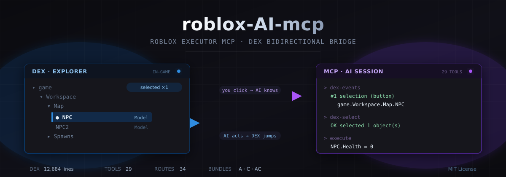
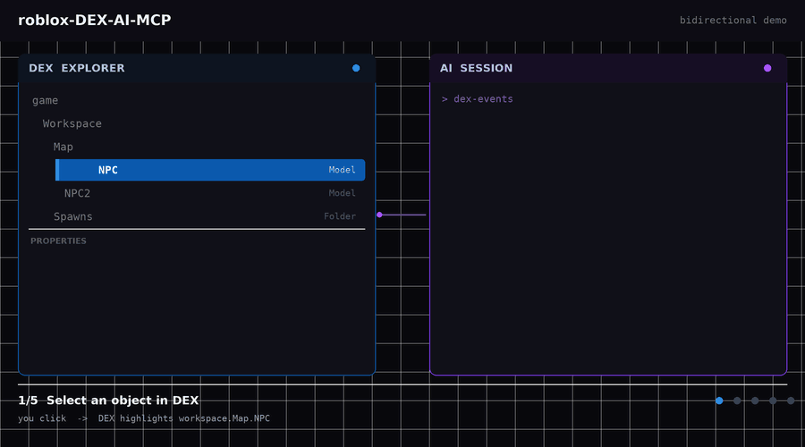
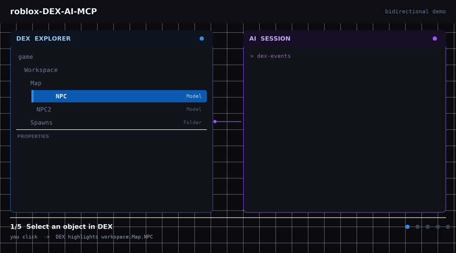
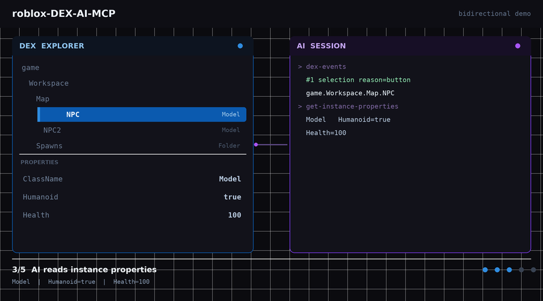
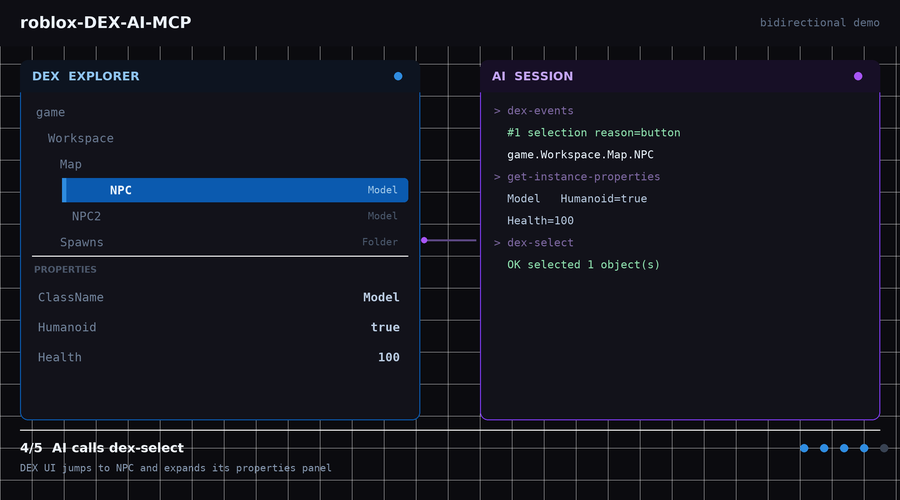
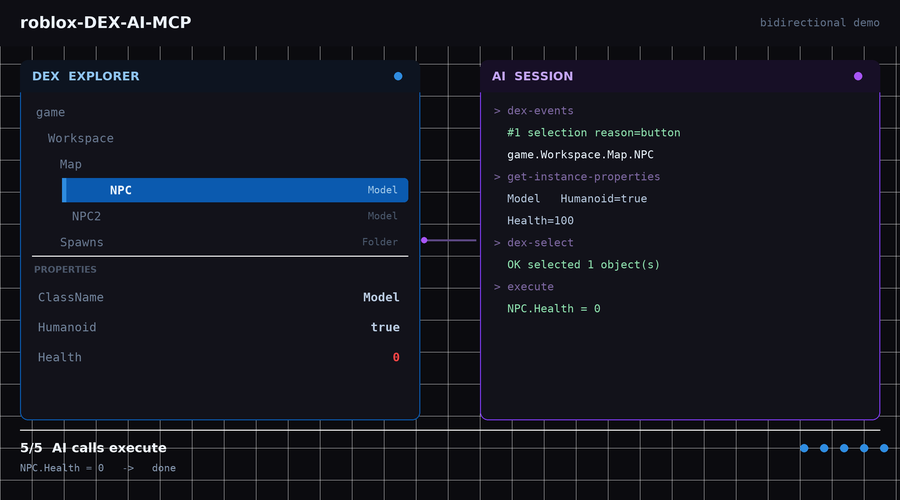

<p align="center">
  
</p>

<h1 align="center">dex-mcp</h1>

<p align="center">
  <strong>独立 DEX 整合包 —— AI 桥接已经内置好</strong><br/>
  <sub>不用打补丁，不用编译。下载一个文件，运行，完事。</sub>
</p>

<p align="center">
  
  
  
</p>

<p align="center">
  <a href="README.md">English</a> · <strong>中文</strong>
</p>

---

> ### 🤖 全部由 AI 完成
>
> 这个文件夹里的每一个文件 —— 三个补丁模块、四个预构建的 dex.lua 整合包、
> 这份 README 以及全部配图 —— 都由 **`deepseek-v4.1-flash`** 编写。
> 这里没有任何一行代码是人写的。

---

## 这个文件夹里有什么

给你**两种**用法：预构建整合包（最省事），或者补丁（想自己动手的话）。

### 方式一 —— 预构建整合包（`builds/`）

完整的 `dex.lua`，桥接已经合并进去。**直接粘贴运行即可。**

| 文件 | 大小 | 你得到什么 |
|---|---|---|
| `builds/dex_A.lua` | 494 KB | 读写 API —— AI 能读你的选中，也能反向操控 DEX |
| `builds/dex_B.lua` | 490 KB | 同样 API，自包含变体 |
| `builds/dex_C.lua` | 493 KB | 浮动 **[→ MCP]** 按钮 + 右键菜单 + 快捷键 |
| `builds/dex_AC.lua` | 510 KB | **两个都要** —— 推荐 ⭐ |

### 方式二 —— 补丁（`dex_mcp_*.lua`）

如果你想保留自己的 `dex.lua` 不动，自己动手应用桥接：

| 文件 | 怎么用 |
|---|---|
| `dex_mcp_A.lua` | 追加到 `dex.lua` **末尾**，即 `Main.Init()` 之后 |
| `dex_mcp_B.lua` | 独立加载 —— 运行时下载 dex.lua 再合并 |
| `dex_mcp_C.lua` | 追加到 `dex.lua` **末尾**（会加按钮 UI） |

---

## 快速开始

### 最快的路

1. 打开本仓库的 `builds/dex_AC.lua`
2. 复制**整个文件**
3. 粘到执行器里，运行

就这样。你会看到：

```
[DEX-MCP] 方案A 已注入 | version=mcp-A-1.0
[DEX-MCP] 方案C 已注入 | version=mcp-C-1.0
```

DEX 界面打开，右下角出现一个小小的 **[→ MCP]** 按钮。

### 把它连到 AI

在执行器里，**加载 DEX 整合包之前**：

```lua
getgenv().BridgeURL = "http://localhost:16384"      -- 本地服务
-- getgenv().BridgeURL = "https://xxx-16384.app.github.dev"   -- Codespaces
```

不设也没关系 —— DEX 照常能用，只是进入「只读模式」
（AI 依然可以查询，但不会往 `/dex/event` 推送）。

---

## 效果演示

<p align="center">
  
  <br/>
  <sub>在 DEX 里选中 → 点按钮 → AI 拿到精确路径 → AI 反过来能把你送回那个对象</sub>
</p>

### 分步图解

<table>
<tr>
<td width="50%" align="center">
  
  <br/><b>1.</b> 在 DEX 里选中任意对象
</td>
<td width="50%" align="center">
  
  <br/><b>2.</b> 点 <b>[→ MCP]</b> —— 路径进队列
</td>
</tr>
<tr>
<td width="50%" align="center">
  
  <br/><b>3.</b> AI 读到真实属性
</td>
<td width="50%" align="center">
  
  <br/><b>4.</b> AI 也能让 DEX 跳到任意对象
</td>
</tr>
<tr>
<td colspan="2" align="center">
  
  <br/><b>5.</b> 然后动手 —— 改属性、跑代码、触发 Remote
</td>
</tr>
</table>

---

## 三套方案

### A —— 完整读写 API

把 `getgenv().DEX` 暴露出来，桥接能做的全都在里面。

```lua
getgenv().DEX.Snapshot()                              -- 现在选中了什么
getgenv().DEX.Select({"game.Workspace.Map.NPC"})      -- 让 DEX 跳过去
getgenv().DEX.Tree("game.Workspace", 3, 200)          -- 导出层级
getgenv().DEX.Props("game.Workspace.Map.NPC")         -- 读属性
getgenv().DEX.Source("game:GetService('ReplicatedStorage').Mods.Combat")  -- 反编译
getgenv().DEX.SetProp("game.Workspace.Map.NPC", "Health", "0")
getgenv().DEX.Run("return 1+1")
```

### B —— 运行时包装

磁盘上的 `dex.lua` 保持原版。运行时下载、在内存里合并桥接、执行一次。

```lua
loadstring(game:HttpGet("https://raw.githubusercontent.com/986mn/roblox-DEX-AI-MCP/main/dex_mcp_B.lua"))()
```

适合你想跟着上游 DEX 更新走、不想每次重新打补丁的场景。

### C —— 可见按钮

加一个可拖动的 **[→ MCP]** 按钮（右下角）、一个右键菜单项，
以及 `Ctrl+Shift+M` 快捷键。按钮上的小角标显示当前选中几个对象。

点一下 → 路径进队列 **并** 复制到剪贴板。

---

## API 参考

### 读

| 调用 | 返回 |
|---|---|
| `DEX.Snapshot()` | `{selection, selectionPaths, selectionCount, apps, pendingCount, uptime, ...}` |
| `DEX.Info(node)` | `{name, class, path, parent, position?, health?, hasHumanoid?}` |
| `DEX.Tree(path, depth, limit)` | 嵌套 `{name, class, children[]}` |
| `DEX.Props(path)` | `{properties, attributes, tags}` |
| `DEX.Source(path)` | `{source, length, class}`（需要执行器的 `decompile`） |

### 写

| 调用 | 效果 |
|---|---|
| `DEX.Select(paths, additive?)` | 在 DEX 界面里选中 + 滚动到可见 |
| `DEX.SetProp(path, prop, value)` | 设置属性（或 Attribute）。加 `lua:` 前缀可求值 |
| `DEX.App(name, open?)` | 显示/隐藏 DEX 面板 |
| `DEX.Refresh()` | 强制刷新树和属性 |
| `DEX.Run(code)` | 执行 Luau，返回结果 |

### 队列（仅 C）

| 调用 | 效果 |
|---|---|
| `DEX_QUEUE.Send(reason?)` | 推送当前选中 |
| `DEX_QUEUE.Take()` | 读取**并清空**队列 |
| `DEX_QUEUE.Peek()` | 只读不清空 |
| `DEX_QUEUE.Selected()` | 只返回当前路径 |

---

## 路径语法

三套方案都支持 DEX 自己产出的全部格式：

```lua
game.Workspace.Map.NPC                          -- 普通
Workspace.Map.NPC                                -- 可省略 "game."
game:GetService("ReplicatedStorage").Mods        -- 服务
game.Workspace:GetChildren()[3]                  -- 重名索引
game.Workspace["奇怪的名字"]                      -- 特殊字符
```

---

## 环境要求

- Roblox 执行器，需支持 `loadstring`、`getgenv`、`request`
- `decompile` —— 只有 `DEX.Source()` 需要
- 可选：`WebSocket` 用于更快的传输（不支持会自动回退到 HTTP 轮询）

---

## 已知限制

1. **nil 实例无法反向解析** —— DEX 对无父对象会输出 `getNil(...)` 代码片段，那不是可解析的表达式。你能读到路径，但没法跳过去。
2. **`DEX.Source()` 取决于执行器** —— 没有 `decompile` 就回退到 `.Source`，通常都是空的。
3. **仅限 Luau** —— DEX 用了 `continue` 和 `..=`，纯 Lua 解析不了。只能在 Roblox 执行器里跑。
4. **推送需要服务端路由** —— 不设 `getgenv().BridgeURL` 就是只读模式。不会报错，只是不推送。

---

## 验证记录

每个整合包都检查了这些项：

| 检查项 | 结果 |
|---|---|
| dex 主体完整（以 `-- https://github.com/LorekeeperZinnia/Dex` 开头） | ✅ 4 个全过 |
| `Main.Init()` 出现在桥接代码**之前** | ✅ 4 个全过 |
| 桥接代码位于文件末尾 | ✅ 4 个全过 |
| 文件以正确的 `end` 收尾 | ✅ 4 个全过 |
| 语法有效（Luau 专有语法已降级供检查） | ✅ 4 个全过 |
| 桥接 API 功能测试（11 项） | ✅ A / B |
| 按钮 UI 功能测试（8 项） | ✅ C |
| A + C 同时装 | ✅ 无变量冲突 |

---

## 致谢

- **DEX** —— [LorekeeperZinnia/Dex](https://github.com/LorekeeperZinnia/Dex)，作者 Moon（12684 行，核心未修改）
- **MCP 服务端** —— [roblox-DEX-AI-MCP](../README.md)
- **桥接代码、整合包、文档、配图** —— `deepseek-v4.1-flash`

## License

MIT